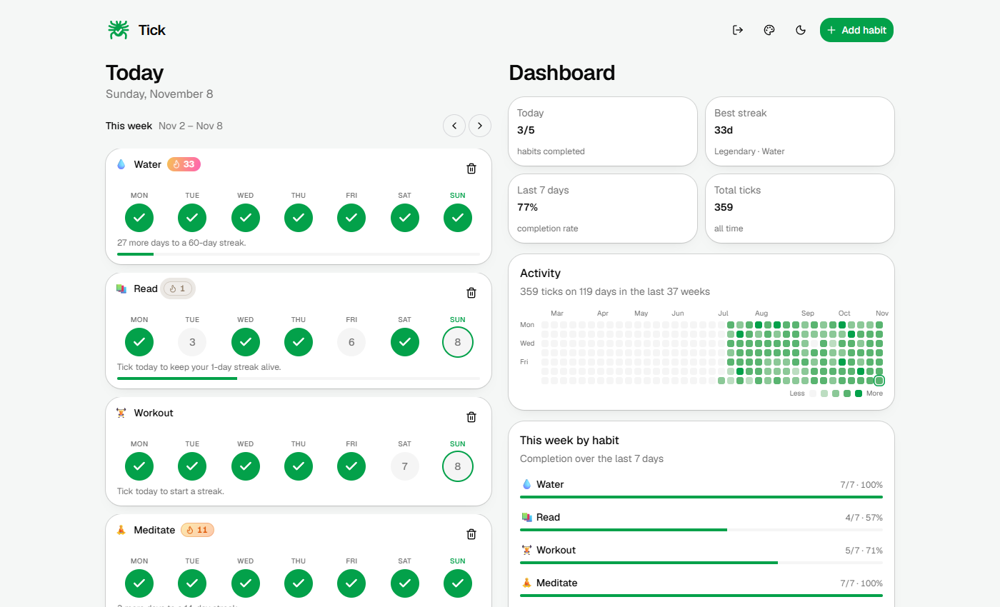
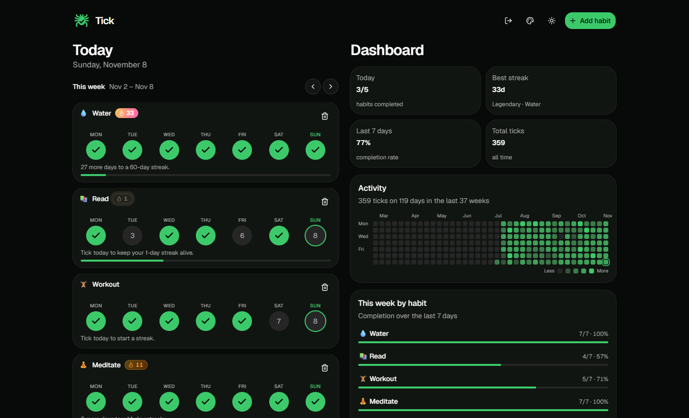
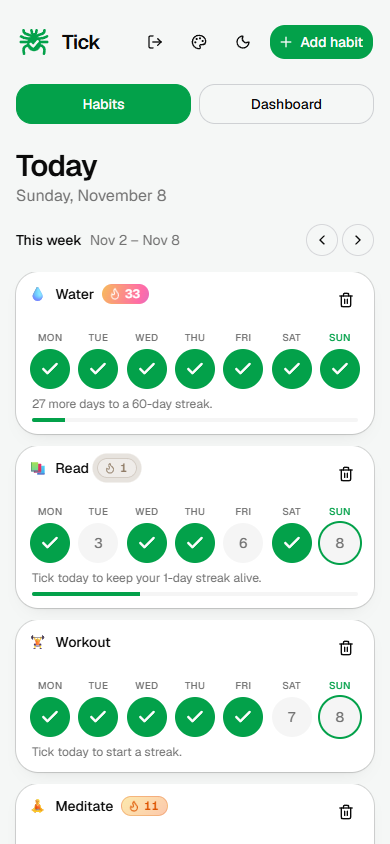

# Tick

A habit tracker. React + shadcn/ui front end, tiny dependency-free Node server, data in a JSON file.



- **Habits view:** one Monday-to-Sunday week at a time; page through weeks with the arrows.
- **Dashboard:** today's progress, best streak, 7-day completion rate, total ticks, activity heatmap, per-habit weekly bars.
- Responsive: tabs on phones, side-by-side on desktop. Light/dark.
- **Accent color:** the palette button next to the light/dark toggle switches the main color between seven options
  (green, teal, blue, violet, pink, orange, red). It's remembered per browser. Colors live in `src/index.css` under `[data-accent]`.

## Run with Docker

A prebuilt image is published to GitHub Container Registry on every release
(`ghcr.io/jgarza9788/tick-habit-tracker`), so you don't need to clone or build anything.

1. Save [`docker-compose.yml`](docker-compose.yml) somewhere (or clone this repo).
2. Start it:

   ```
   docker compose up -d
   ```

3. Open http://localhost:3000 and create your account on first visit.

Or without compose:

```
docker run -d --name tick -p 3000:3000 -v tick-data:/data --restart unless-stopped   ghcr.io/jgarza9788/tick-habit-tracker:latest
```

### Configuration

| Setting | How | Default |
|---|---|---|
| Port | change the left side of `"3000:3000"` in `docker-compose.yml` | `3000` |
| Data location | `TICK_DATA` env var or `.env` file. A volume name or a host path such as `./data` | named volume `tick-data` |
| Pre-create the account | uncomment `TICK_USERNAME` / `TICK_PASSWORD` in `docker-compose.yml` | created on first visit |

The container fixes ownership of `/data` on start, so bind mounts and NAS shares work without a manual `chown`
(`EACCES ... /data/secret.key` on an older image means you need v0.1.1 or later). To run as a specific user instead, add
`user: "1000:1000"` to the service, and make sure that user can write to the folder.

### Updating

```
docker compose pull && docker compose up -d
```

Your data lives in the volume, so it survives updates. Releases are tagged `vX.Y.Z`; the image is
published as `X.Y.Z`, `X.Y` and `latest`. To pin a version, edit the tag in `docker-compose.yml`.

### Build from source

Comment out `image:` and uncomment `build: .` in `docker-compose.yml`, then `docker compose up --build`.

## Run on Windows (no Docker)

Requires Node.js 20+.

```
.\launcher.ps1                 # installs, builds if needed, starts, opens browser
.\launcher.ps1 -Port 8080 -NoBrowser
.\launcher.ps1 -Rebuild
```

Data is stored in `.\data\habits.json` (change with `-DataDir`).

## Screenshots

| Dark mode | Phone |
|---|---|
|  |  |

## Using Tick

- **Add a habit:** the green **Add habit** button; type a name; start it with an emoji if you want one.
- **Tick a day:** click the circle for that day. Click again to undo. You can fill in past days; future days can't be ticked.
- **Move through time:** the arrows next to the week label page back and forward.
- **Dashboard:** today's progress, streaks, completion rate, the activity heatmap and per-habit weekly bars. On phones it's the second tab. Tap, hover or focus a heatmap day for its details; with the keyboard, Tab into the heatmap and use the arrow keys.
- **Theme and color:** the moon button toggles light/dark, the palette button changes the accent color.
- **Rename a habit:** the pencil icon on its card. Ticks and streaks are kept.
- **Delete a habit:** the trash icon on its card.
- **Archive a habit:** the archive icon on its card hides it from Today and the dashboard but keeps its history. Use **Undo** in the toast, or open **Archived** at the bottom of the list to restore it.
- **Reorder habits:** press and hold a habit card (about a third of a second), then drag it up or down and let go. Works with mouse and touch; the list scrolls when you drag near the screen edge. Keyboard users can Tab to the hidden "Move up / Move down" buttons on each card.
- **Habit details:** click a habit's name under **This week by habit** on the dashboard. You get its current and longest streak, completion rate, a month calendar you can tick, the last 12 weeks, and a notes box. The URL is `#/habit/<id>`, so back/forward and bookmarks work.
- **Install as an app:** open Tick in Chrome, Edge or Safari and choose *Install* / *Add to Home Screen*. It opens full-screen and the shell loads offline, but habit data always comes from the server, so you need a connection to see or change habits.
- **Back up and restore (desktop):** the download and upload buttons in the header export all habits as a JSON file and restore one. Importing replaces your current habits, so export first.

## Streak celebrations

Hitting a streak milestone plays a full-screen effect, and each level looks different and is bigger than the last:

| Days | Effect |
|---|---|
| 3 | Twinkling stars |
| 7 | A wall of heat with rising embers and flames |
| 14 | Shockwave rings, speed lines and a screen shake |
| 30 | Rotating rays of light, a crown that drops in, a golden shower |
| 60 | Warp speed: stars streak past and a rocket blasts across the screen |
| 100 | Fireworks launch and burst, confetti and a giant trophy |
| 150 | Bigger fireworks with a star |
| 200 | Even bigger fireworks with a diamond |
| 365 | One year: golden fireworks, rays of light, coins, crown and trophy |

Each one is longer and bigger than the last, and scales to the screen (phone to big monitor).
Preview any of them without waiting: open the browser console and run `tickCelebrate(365)`.
They are skipped when the system's "reduce motion" setting is on (the toast still shows).

## Sign-in

Tick has a single username + password account.

- **First run:** the first person to open the app is asked to create the account. If the server is reachable by others
  before you've done that, set `TICK_USERNAME` and `TICK_PASSWORD` instead (see `docker-compose.yml`): the account is
  created at startup and nobody can claim it first.
- **Change password:** account menu, then *Change password*. You stay signed in on that device; every other device is signed out.
- Passwords are stored as salted **scrypt** hashes (never plain text) in `auth.json` next to the data. Minimum 8 characters.
- You stay signed in for 30 days (HttpOnly, SameSite=Strict cookie, signed with a key in `secret.key`; both files live in
  the data folder). Sign out and password change are in the account (person) menu in the header.
- All habit data endpoints require sign-in. Failed logins and account-setup attempts are rate-limited (8 per 15 minutes per address), and cross-origin
  writes are rejected. Responses carry CSP / no-sniff / no-framing headers.
- **Behind a reverse proxy?** Send `X-Forwarded-Proto: https` so the cookie is marked `Secure`, and either keep the
  original `Host` header or send `X-Forwarded-Host` (writes from another origin are rejected). Also set
  `TRUST_PROXY=1` (the number of proxies in front of Tick) so the login and setup rate limits see each visitor's
  address, taken from the right of `X-Forwarded-For`. Without it they use the proxy's address, so all visitors share one
  limit, and the header is ignored (so it can't be spoofed). Over HTTPS (`X-Forwarded-Proto: https`) Tick also sends
  `Strict-Transport-Security`.
- **Sessions are revocable.** Each sign-in is remembered in `sessions.json` (data folder), so signing out ends that
  session for real (a copied cookie stops working) and changing the password ends all of them. Updating from an older
  version signs everyone out once.
- **Forgot the password?** Stop Tick and delete `auth.json` from the data folder (Docker: `docker compose exec tick rm /data/auth.json`,
  then restart). Your habits are untouched; you'll be asked to create the account again. Deleting `secret.key` signs everyone out.

## Releasing

Bump `version` in `package.json`, move the "Unreleased" entries in `CHANGELOG.md` under the new version, commit, then tag and push:

```
git tag vX.Y.Z && git push origin vX.Y.Z
```

The `Docker build` workflow publishes the image to GHCR for any `v*` tag. `docker-compose.yml` follows `latest`; set `TICK_VERSION=X.Y.Z` (shell or `.env`) to pin a release.

## Develop

```
npm run server   # API on :3000 (needs a build for static files, or just use dev below)
npm run dev      # Vite dev server, proxies /api to :3000
npm test         # unit tests (Vitest) + server API tests (node:test)
```
